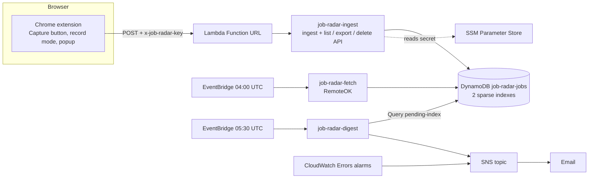

# job-radar

[](https://github.com/amine-hassoun/job-radar/actions/workflows/checks.yml)

A personal, serverless job-search pipeline that costs **$0/month**.

It captures the LinkedIn postings I open, pulls fresh remote listings from RemoteOK every day, scores every job against my profile with a transparent algorithm, and emails me one ranked digest each morning. A Chrome extension puts a **Capture** button on every posting and lets me copy the best matches, with their full descriptions, straight into a chat to write cover letters.

No servers, no LLM calls, no paid AWS services. Everything runs on the AWS Always Free tier and is defined in Terraform.

- [Quick start (5 minutes)](#quick-start-5-minutes)
- [What it does](#what-it-does)
- [Architecture](#architecture)
- [How it works](#how-it-works)
- [Repository layout](#repository-layout)
- [Cost: why it is $0](#cost-why-it-is-0)
- [Security decisions](#security-decisions)
- [Full tutorial: step by step](#full-tutorial-step-by-step)
- [Operations](#operations)
- [Testing and CI](#testing-and-ci)
- [Design decisions and lessons learned](#design-decisions-and-lessons-learned)
- [Limitations and roadmap](#limitations-and-roadmap)
- [Responsible use](#responsible-use)

## Quick start (5 minutes)

Works on macOS, Linux and Windows through WSL. You need an AWS account (a personal or sandbox account where your user can create resources), the [AWS CLI](https://docs.aws.amazon.com/cli/latest/userguide/getting-started-install.html) logged in, [Terraform](https://developer.hashicorp.com/terraform/install) 1.6 or newer, and Chrome (or Edge, Brave...).

```bash
aws configure                                   # once, if the AWS CLI is not logged in yet
git clone https://github.com/amine-hassoun/job-radar.git && cd job-radar
./scripts/quickstart.sh you@example.com         # your email: where the daily digest goes
```

Then the one step a script cannot do: open `chrome://extensions`, turn on **Developer mode**, click **Load unpacked** and choose the `extension/` folder (the script prints its exact path; under WSL it prints the Windows path).

That is all. The script takes a few minutes and:

| Step | What happens |
|---|---|
| 1 | Checks that `aws`, `terraform` and `openssl` are installed and that your AWS credentials and region work. |
| 2 | Tells you exactly what it will create and asks before doing anything (`--yes` skips the question). |
| 3 | Creates the shared secret in SSM Parameter Store. It never enters Terraform state. |
| 4 | Deploys everything with Terraform: 3 Lambda functions, 1 DynamoDB table, 2 schedules, 1 SNS topic, 3 alarms. |
| 5 | Writes `extension/config.js` with your endpoint and secret, and points `manifest.json` at your region. |
| 6 | Loads the first jobs from RemoteOK, so the popup is not empty. |
| 7 | Waits for you to click the confirmation link AWS emails you, then sends your first digest. |

When it finishes you have:

- a **Capture** button next to Save on every LinkedIn job (after you load the extension);
- your RemoteOK matches in the extension popup;
- the first digest in your inbox, then one every day at 05:30 UTC.

Good to know:

- **Cost:** $0/month. Nothing it creates bills by the hour.
- **Region:** the one your AWS CLI is set to (override with `export AWS_REGION=...`).
- **State:** Terraform state stays in `infra/` on your machine. Keep that folder; the [full tutorial](#full-tutorial-step-by-step) shows how to move state to S3.
- **Re-running is safe:** an existing secret is kept and Terraform only applies what changed.
- **Permissions:** your AWS user needs to create Lambda, DynamoDB, IAM roles, SNS, EventBridge, CloudWatch and SSM resources. On a personal account, `AdministratorAccess` is the simplest.
- **Check it:** `./scripts/verify.sh` runs about 40 end-to-end checks (it needs Python only for its small helpers).
- **Remove it:** see [Tear it all down](#12-tear-it-all-down).
- **Make it yours:** the next thing to do is edit `infra/lambda/src/profile.json` (your skills, target titles, score threshold), then run `terraform -chdir=infra apply`. [Details here](#10-make-it-yours).

## What it does

| Capability | How |
|---|---|
| **Capture a LinkedIn posting** | A **Capture** button appears next to Save on every job. One click stores the title, company, location and full description. It becomes **Captured ✓**, or **Applied ✓** once removed. |
| **Record mode** | Optional toggle: every posting I open is captured automatically. It never navigates or scrolls for me; the only thing it clicks is the description's "… more" link, to read the full text. |
| **Pull remote jobs daily** | A scheduled Lambda reads RemoteOK's public API, scores each listing and stores the relevant ones. |
| **Score every job (0-100)** | Title rules, weighted skills, TF-IDF similarity to my profile, remote and location bonuses, penalties for visa or seniority wording. No model, fully explainable. |
| **Daily email digest** | The best unsent matches, best first, with the skills that matched and a link. |
| **Two job lists in the popup** | **LinkedIn captures** and **RemoteOK matches**, each filterable to "only profile fits". |
| **Copy for Claude** | Copies the checked jobs (or all listed) with full descriptions as one ready-to-paste prompt for cover-letter writing. |
| **Delete after applying** | Removes jobs I applied to, so lists stay short. |
| **Fail loudly** | CloudWatch alarms email me if any function errors. If the fetch fails entirely it raises instead of reporting a quiet zero. |

## Architecture



| Component | Where | Role |
|---|---|---|
| Chrome extension | `extension/` | Manifest V3. Content script (button, record mode), service worker (all network calls), popup (lists, copy, delete). |
| `job-radar-ingest` | `infra/lambda/src/ingest.py` | One Function URL, shared-secret auth. Stores scored captures and serves the list / export / delete actions. |
| `job-radar-fetch` | `infra/lambda/src/fetch.py` | Daily RemoteOK pull. Not attached to a VPC, so it has free internet access. |
| `job-radar-digest` | `infra/lambda/src/digest.py` | Daily email of the best unsent matches. |
| Scoring | `infra/lambda/src/scoring.py`, `profile.json` | The algorithm and all of its tunable data. |
| DynamoDB | `infra/database.tf` | One table, two sparse indexes, TTL. |
| Terraform | `infra/*.tf` | Everything above, plus IAM, schedules, SNS and alarms. |

## How it works

### A job's life

1. **Arrival.** Either I click Capture on LinkedIn (extension → Function URL → `ingest`), or the 04:00 UTC schedule runs `fetch`, which downloads RemoteOK's listings.
2. **Scoring.** Each job is scored once, at write time, so later reads never need the description.
3. **Storage.** The job is written with a conditional put (`attribute_not_exists(job_id)`), which makes every write idempotent: re-capturing or re-fetching a known job is a no-op.
4. **Indexing.** Two *sparse* indexes pick up the items that matter (see below).
5. **Digest.** At 05:30 UTC `digest` queries the pending index, emails the best 25, then marks those jobs as notified.
6. **Reading.** The popup lists, exports and deletes through the same Function URL.
7. **Expiry.** A DynamoDB TTL removes everything after 30 days.

### Scoring

Scores run 0-100. Everything tunable lives in `infra/lambda/src/profile.json`, not in code.

| Component | Points | Notes |
|---|---|---|
| Target title (DevOps, SRE, Platform, Cloud, ...) | +30 | An excluded title (intern, sales, manager, ...) is **-30** instead. |
| Skills matched | up to +40 | Weighted: Terraform 9, Kubernetes 9, AWS 8, GitHub Actions 6, CI/CD 5, Docker 5, Helm/Prometheus/Ansible/IaC 4 each, and smaller weights for the rest. Capped at 40. |
| TF-IDF similarity to my profile text | up to +10 | Cosine similarity with sublinear TF and smoothed IDF; 0.25 or more counts as a full match. |
| Remote | +10 | Detected in title, location or the first 1,500 characters of the description. |
| Remote or an EU location | +5 | |
| Eligibility wording | -30 | "US only", "must be located in", work authorisation, fluent German/Dutch/...: the job is flagged `check-eligibility` rather than hidden. |
| Seniority wording | -10 | "Principal", "staff engineer", "10+ years", ... flagged `senior-wording`. |

The result is clamped to 0-100. A score of **45 or more** counts as a "fit" (`digest_min_score`); anything under 15 is not stored at all (`store_min_score`). Every stored job keeps the list of skills that matched, so a score is never a black box.

### Data model

One DynamoDB table, `job-radar-jobs`, key `job_id` = `<source>#<external id>` (for example `remoteok#1129482` or `linkedin-extension#4488225901`).

| Attribute | Meaning |
|---|---|
| `title`, `company`, `location`, `url`, `source` | The posting |
| `description` | Full text: up to 12,000 characters for LinkedIn captures, 4,000 for RemoteOK |
| `score`, `matched`, `flags` | Result of the scoring |
| `ingested_at`, `expires_at` | Timestamp and TTL (30 days) |
| `digest_pk` | `PENDING` while the job awaits the digest, removed once it has been emailed |
| `captured_pk` | `CAPTURED` (LinkedIn) or `REMOTEOK`: puts the job in the popup lists |
| `notified_at`, `applied_at` | Set when emailed / when marked applied (RemoteOK tombstone) |

| Index | Key | Used by |
|---|---|---|
| `pending-index` | `digest_pk` + `score` | The digest: reads only unsent matches |
| `captured-index` | `captured_pk` + `score` | The popup lists: one partition per source, sorted by score |

Both are **sparse**: an item only appears in an index while it carries that attribute, so each query reads a handful of small entries instead of scanning the table. That matters because the table has only 2 provisioned read units.

### The API

Everything the extension does goes through one Function URL. Requests are `POST` with the header `x-job-radar-key: <secret>`. The secret is compared in constant time.

| Body | Effect |
|---|---|
| `{"jobs": [...]}` | Ingest up to 100 postings (validated, scored, stored) |
| `{"action": "list", "source": "remoteok", "only_fits": true}` | Jobs for a tab, best score first |
| `{"action": "export", "source": "...", "job_ids": ["..."]}` | Full records with descriptions |
| `{"action": "delete", "source": "...", "job_ids": ["..."]}` | Remove jobs I applied to |

`source` is `linkedin-extension` (default) or `remoteok`. Keys are built server-side from that whitelist, so a request can never touch an arbitrary item.

**Delete works differently per source.** LinkedIn jobs are really deleted. RemoteOK listings stay online for weeks, so the daily fetch would bring a deleted one straight back; instead the job keeps a tiny *tombstone* for 60 days (no description, no list entry, `applied_at` set) and the fetch treats it as already seen.

```bash
curl -s -X POST "$INGEST_URL" -H 'Content-Type: application/json' \
  -H "x-job-radar-key: $KEY" -d '{"action":"list","source":"remoteok","only_fits":true}'
```

### The extension

- **Button placement.** LinkedIn's layout around Apply and Save is fragile, so the button is never inserted into it. It lives in a fixed-position overlay on the page, positioned beside Save from Save's on-screen rectangle. It follows scrolling and resizing, and hides when Save is covered by a modal or scrolled out of view. If Save cannot be found, it floats bottom-right instead.
- **Full descriptions.** LinkedIn shows only the first part of a long description until "… more" is clicked. Before every capture (button, popup or record mode) the extension clicks that control, but only the one inside the description block, never another section's "see more", then waits for the text to grow. A description that is already expanded is captured as is.
- **Finding the data.** LinkedIn's class names are obfuscated, so the content script locates things by structure: the detail pane is the ancestor of the Save button that holds "About the job"; the title is the link to the current job; the company is the `/company/` link; the location is the first item of the "4 days ago · applicants" line.
- **Local mirror.** The service worker keeps `captured` and `deleted` maps in `chrome.storage.local` so buttons render instantly, and re-syncs from the server at most every 10 minutes. Record mode skips anything already captured or deleted, which saves Lambda calls and write units.
- **Safe rendering.** Job titles come from the web, so the popup builds its lists with DOM APIs and `textContent`, never `innerHTML`.

### The digest

```
Subject: Job Radar: 3 new match(es), top score 91

3 new job match(es), best first.

 91 · Platform Engineer — Acme (Worldwide)
      terraform, kubernetes, aws, github actions, ci/cd, docker
      https://remoteok.com/remote-jobs/...
```

The digest publishes first and marks jobs second: a failure in between can repeat a job tomorrow, but can never lose one.

## Repository layout

```
job-radar/
├── extension/                 Chrome extension (Manifest V3)
│   ├── manifest.json
│   ├── content.js             Capture button, record mode, page parsing
│   ├── background.js          Service worker: network calls, local state
│   ├── popup.html / popup.js  Lists, copy for Claude, delete
│   └── config.example.js      Copy to config.js (gitignored)
├── infra/                     Terraform
│   ├── backend.tf providers.tf versions.tf variables.tf
│   ├── common.tf              Shared zip, assume-role policy
│   ├── database.tf            Table, two sparse indexes, TTL
│   ├── ingest.tf fetch.tf digest.tf   One file per Lambda (role, function, schedule)
│   ├── monitoring.tf          Error alarms
│   └── lambda/src/            Python source of all three functions
│       ├── ingest.py fetch.py digest.py
│       ├── scoring.py store.py
│       └── profile.json       All scoring data
├── scripts/                   quickstart.sh, verify.sh, reset_data.py, export_remoteok.py, backfill_captured.sh
├── tests/                     pytest + moto
├── .github/workflows/checks.yml
└── .checkov.yaml              Accepted IaC findings, each with a reason
```

## Cost: why it is $0

No service here bills by the hour, and each one stays inside its permanent free allowance.

| Service | Use | Free allowance |
|---|---|---|
| Lambda | 3 functions, tiny memory, a few dozen invocations a day | 1M requests and 400,000 GB-seconds a month, always free |
| Lambda Function URL | The extension's endpoint | No charge |
| DynamoDB, **provisioned** | Table 2 RCU / 4 WCU, two indexes at 1/1 each, 4 / 6 in total | 25 RCU / 25 WCU and 25 GB, shared by every table in the account and region |
| EventBridge | 2 scheduled rules | Scheduled rules are free |
| CloudWatch | 3 alarms, 14-day log retention | 10 alarms and 5 GB of logs |
| SNS | One email a day | 1,000 email notifications a month |
| SSM Parameter Store | 1 standard parameter | Free |
| S3 | Terraform state | A few KB: well under a cent |

Deliberately **not** used, because they bill hourly with no free tier: NAT Gateway, load balancers, EC2, RDS, and DynamoDB on-demand mode. Three guards keep it that way (see [Security decisions](#security-decisions)).

## Security decisions

- **Auth.** The Function URL uses `AuthType NONE` (which needs *two* resource-policy statements: `lambda:InvokeFunctionUrl` and `lambda:InvokeFunction`) and is protected by a shared secret held in SSM Parameter Store as a `SecureString` and compared in constant time. The secret never enters Terraform state.
- **Least privilege.** One IAM role per function, each limited to the exact actions and resource ARNs it uses. The digest cannot write jobs; the fetcher cannot read the secret.
- **Narrow API.** Source whitelist, numeric ID validation, batch limits, and keys built server-side.
- **No VPC on purpose.** The fetcher calls a public API; attaching it to a VPC would require a NAT Gateway, which is not free.
- **Cost guards.** CI fails on any NAT Gateway, load balancer, EC2/RDS/EKS resource, `PAY_PER_REQUEST` table or `vpc_config`. An optional IAM deny policy (below) blocks creating those resources at all.
- **Passive capture.** The extension reads only the posting that is open in my own browser, at human pace. Its only interaction with the page is expanding that posting's description.
- **Secrets stay out of Git.** `extension/config.js`, `*.tfvars` and state files are gitignored.

## Full tutorial: step by step

The [quick start](#quick-start-5-minutes) is the same thing in one command. Use this version to understand each step, keep Terraform state in S3, or run the pieces by hand. About 30 minutes. Every command is copy-paste; the expected result follows each one.

### 0. Prerequisites

| Tool | Version | Check |
|---|---|---|
| AWS account + CLI v2 | any | `aws --version` |
| Terraform | 1.6+ (1.10+ for `use_lockfile`) | `terraform version` |
| Python | 3.12+ (only to run tests and `scripts/`) | `python3 --version` |
| `curl`, `git`, `openssl` | any | |
| Chrome / Edge / Brave | any recent | |

### 1. Get the code

```bash
git clone https://github.com/amine-hassoun/job-radar.git
cd job-radar
```

**Not using `eu-west-3` (Paris)?** Three places carry the region: `aws_region` in `terraform.tfvars` (step 4), `region` in `infra/backend.tf` (step 3), and the `host_permissions` URL in `extension/manifest.json` (the quick start script patches this one for you).

### 2. Point the AWS CLI at your account

```bash
aws configure --profile job-radar        # access key, secret key, region (e.g. eu-west-3)
export AWS_PROFILE=job-radar
export AWS_PAGER=""                      # stops the CLI from paging output
aws sts get-caller-identity              # expect: your account id
```

Use an IAM user, not the root account. Optional but recommended: attach this inline **deny** policy to that user. It makes it impossible to create anything that bills by the hour, even by mistake.

```json
{
  "Version": "2012-10-17",
  "Statement": [{
    "Sid": "DenyExpensiveResourcesNotUsedInThisProject",
    "Effect": "Deny",
    "Action": [
      "ec2:RunInstances", "ec2:CreateNatGateway", "ec2:AllocateAddress",
      "elasticloadbalancing:CreateLoadBalancer",
      "rds:CreateDBInstance", "rds:CreateDBCluster",
      "redshift:CreateCluster",
      "elasticache:CreateCacheCluster", "elasticache:CreateReplicationGroup",
      "eks:CreateCluster"
    ],
    "Resource": "*"
  }]
}
```

### 3. Create the Terraform state bucket

The repository's `backend.tf` points at the author's bucket, so replace it with your own.

```bash
BUCKET="<your-unique-name>-job-radar-tfstate"
REGION=eu-west-3
aws s3api create-bucket --bucket "$BUCKET" --region "$REGION" \
  --create-bucket-configuration LocationConstraint="$REGION"
aws s3api put-bucket-versioning --bucket "$BUCKET" --versioning-configuration Status=Enabled
aws s3api put-bucket-encryption --bucket "$BUCKET" \
  --server-side-encryption-configuration '{"Rules":[{"ApplyServerSideEncryptionByDefault":{"SSEAlgorithm":"AES256"}}]}'
aws s3api put-public-access-block --bucket "$BUCKET" \
  --public-access-block-configuration BlockPublicAcls=true,IgnorePublicAcls=true,BlockPublicPolicy=true,RestrictPublicBuckets=true
```

(In `us-east-1`, omit `--create-bucket-configuration`.) Then replace the contents of `infra/backend.tf`:

```hcl
terraform {
  backend "s3" {
    bucket       = "<your-unique-name>-job-radar-tfstate"
    key          = "job-radar/terraform.tfstate"
    region       = "eu-west-3"
    encrypt      = true
    use_lockfile = true   # state locking in S3 itself (Terraform 1.10+)
  }
}
```

On Terraform 1.6 to 1.9, create a small DynamoDB lock table instead and use `dynamodb_table = "<name>"`. Keep it at 1 RCU / 1 WCU, since it draws from the shared free pool.

### 4. Set your email and create the secret

```bash
cd infra
cat > terraform.tfvars <<'TFVARS'                                   # gitignored
notification_email = "you@example.com"
aws_region         = "eu-west-3"
TFVARS

aws ssm put-parameter --name /job-radar/ingest-shared-secret --type SecureString \
  --value "$(openssl rand -hex 32)"
```

The secret lives only in SSM and in your extension config. Terraform only references its name.

### 5. Deploy

```bash
terraform init
terraform plan -out tfplan
```

Read the plan. For a fresh account it should end with about **27 to add, 0 to change, 0 to destroy**, and no NAT Gateway, load balancer or instance. Then:

```bash
terraform apply tfplan
```

Expected outputs: `ingest_url`, `jobs_table_name`, `sns_topic_arn`. (`aws_region` defaults to `eu-west-3` if you leave it out.) You will see harmless "deprecated argument" warnings about `hash_key` / `range_key`; they do not affect the result.

### 6. Confirm the email subscription

AWS emails you a confirmation link. **Click it**, or neither the digest nor the error alarms will reach you.

```bash
aws sns list-subscriptions-by-topic --topic-arn "$(terraform output -raw sns_topic_arn)" \
  --query 'Subscriptions[0].SubscriptionArn' --output text      # expect an ARN, not PendingConfirmation
```

### 7. First run

```bash
aws lambda invoke --function-name job-radar-fetch --cli-read-timeout 130 /dev/stdout
aws lambda invoke --function-name job-radar-digest /dev/stdout
```

Expect a summary such as `{"fetched": 97, "stored": 58, "duplicates": 0, "skipped": 39, "errors": []}` and `{"sent": 7}`. A few minutes later the digest email arrives.

### 8. Install the extension

```bash
cd ../extension
cp config.example.js config.js
```

Edit `config.js`: set `endpoint` to the `ingest_url` output, and `key` to the secret:

```bash
aws ssm get-parameter --name /job-radar/ingest-shared-secret --with-decryption \
  --query Parameter.Value --output text
```

Then in Chrome: `chrome://extensions` → turn on **Developer mode** → **Load unpacked** → select the `extension/` folder. Open any LinkedIn job: a **Capture** button appears beside Save. Click it and it turns into **✓ Captured**. Open the extension popup to see your lists.

If you run Chrome on Windows and the repo in WSL, load the folder through its Windows path (`\\wsl$\<distro>\home\<you>\job-radar\extension`), so Chrome reads the files you are editing.

### 9. Verify everything

```bash
cd ..
python3 -m venv .venv && source .venv/bin/activate
pip install boto3 "moto[dynamodb,ssm,sns]" pytest
pytest tests -q            # 35 passed
./scripts/verify.sh        # about 40 end-to-end checks against your AWS account
```

`verify.sh` checks drift, indexes, the capacity pool, function settings, the subscription, schedules, alarms, the API (auth, validation, scoring, duplicates, list, export, delete for both sources), a live fetch and a real digest email. It creates two synthetic jobs and deletes them at the end. Expect `RESULT: N passed, 0 failed`.

### 10. Make it yours

Edit `infra/lambda/src/profile.json`, then `terraform apply` (the zip hash changes, so the three functions update).

| Field | What it controls |
|---|---|
| `profile_text` | The text every posting is compared with (TF-IDF). Put your skills and role words here. |
| `title_include` / `title_exclude` | Which titles earn +30 / -30 |
| `skills` | `{name, weight, pattern}` rules. Weights add up to at most 40 points. |
| `remote_pattern`, `location_ok_pattern` | Remote and location bonuses |
| `eligibility_patterns` | Visa, residency and language wording to flag |
| `seniority_penalty_pattern` | Wording that suggests the wrong seniority |
| `digest_min_score` | Score needed to count as a fit and be emailed (default 45) |
| `store_min_score` | Score under which a RemoteOK job is not stored (default 15) |
| `max_digest_items` | Maximum jobs per email (default 25) |

A good tuning loop: open the RemoteOK tab, look at what scored high and low, adjust weights, apply, then run the fetch again.

### 11. Turn on CI (optional)

Push to your own GitHub repository. `.github/workflows/checks.yml` needs no secrets: it runs the cost guard, `terraform fmt`/`validate`, the tests and checkov. Dependabot keeps the actions and providers current.

### 12. Tear it all down

```bash
cd infra && terraform destroy
aws ssm delete-parameter --name /job-radar/ingest-shared-secret
aws s3 rb "s3://$BUCKET" --force
```

### Troubleshooting

| Symptom | Likely cause and fix |
|---|---|
| Description looks cut short | Open the console, filter by `job-radar` and capture again. `description expanded: A -> B characters` means it worked. `clicked "more" but the description did not grow` or no message at all means LinkedIn's control text differs: adjust `MORE_RE` in `content.js`. Jobs captured before this fix keep their short text: delete and capture them again. |
| Quick start: "no working credentials" | The AWS CLI is not logged in. Run `aws configure`, or `export AWS_PROFILE=<name>`, then run the script again. |
| Quick start: `AccessDenied` during the deploy | Your AWS user lacks permissions. Use an admin user in a personal or sandbox account. |
| Quick start: email not confirmed after 5 minutes | Check spam, then re-send the confirmation: `terraform -chdir=infra apply -replace=aws_sns_topic_subscription.email`. Once confirmed, run `aws lambda invoke --function-name job-radar-digest /dev/stdout`. |
| Quick start: `infra/backend.tf` was renamed | That file points at the author's state bucket, so the script moved it to `backend.tf.disabled` and used local state. Nothing to fix. |
| No Capture button | Open the console and filter by `job-radar`. You should see `content script loaded v...` and `button: beside the Save button`. No version means Chrome is loading an old copy: remove the extension and load the folder again. If LinkedIn changed its markup, adjust `structural()` and `findSaveButton()` in `content.js`. |
| Popup shows "Server rejected the key" | `key` in `config.js` does not match the SSM parameter. |
| Popup shows a network error | Wrong `endpoint`, or the region in `manifest.json` `host_permissions` does not match. |
| No digest email | Subscription still `PendingConfirmation`; or nothing scored 45 or more; or the digest already ran. Check logs: `aws logs tail /aws/lambda/job-radar-digest --since 24h`. |
| Fetch returns `errors` | RemoteOK unreachable or rate limiting. One failing run is harmless; a total failure raises and trips the alarm. |
| First fetch is slow | Provisioned throughput is tiny on purpose; boto3 retries with backoff. Allow up to two minutes. |
| `terraform apply` fails on capacity | Other tables in the account use the shared 25 RCU / 25 WCU pool. `verify.sh` prints the account-wide total. |

## Operations

```bash
./scripts/quickstart.sh you@example.com               # one-command install (safe to re-run)
./scripts/verify.sh                                   # full end-to-end check
aws lambda invoke --function-name job-radar-fetch --cli-read-timeout 130 /dev/stdout   # fetch now
aws logs tail /aws/lambda/job-radar-fetch --since 1h  # recent logs (14-day retention)
python3 scripts/export_remoteok.py --out matches.md   # RemoteOK matches with descriptions, as one file
python3 scripts/reset_data.py                         # erase every stored job (asks you to type DELETE)
./scripts/backfill_captured.sh                        # one-off, for jobs captured before the captured-index existed
```

After `reset_data.py`, clear the extension's cache: `chrome://extensions` → the extension's *service worker* → Console → `chrome.storage.local.clear()`.

## Testing and CI

`pytest` with `moto` (no AWS account needed) runs **35 tests**: scoring (good and bad jobs, eligibility and title flags, similarity range), ingest (auth, validation, duplicates), fetch (parsing, idempotency, total failure raises), digest (sends once, empties the pending index), the API for both sources (list, export, delete, tombstones that block a re-fetch, source isolation, validation), the helper scripts, and the **quick start script itself**, run end to end against stubbed `aws` and `terraform` binaries (fresh install, re-run, unconfirmed email, missing credentials or region, old Terraform, declined prompt, bad usage).

CI (`.github/workflows/checks.yml`) runs on every push and pull request:

1. **Cost guard**: fails on any non-free resource type, `PAY_PER_REQUEST` or `vpc_config`.
2. `terraform fmt -check`, `init -backend=false`, `validate`.
3. The pytest suite.
4. **checkov** against `.checkov.yaml`.

`.checkov.yaml` lists every accepted finding with a reason. They are all deliberate trade-offs of a $0 personal project, for example: no VPC (free internet access), no dead-letter queue (alarms email instead), no auto scaling or KMS customer keys (fixed small capacity, public job data), and public Function URL permissions (required for `AuthType NONE`, gated by the shared secret).

## Design decisions and lessons learned

| Decision | Why |
|---|---|
| Score once at write time | Reads never touch descriptions, so a tiny read budget is enough. |
| Sparse indexes instead of scans | A scan would read every stored description. An index entry exists only while a job is unsent or listed. |
| TF-IDF plus rules instead of an LLM | Free, deterministic, explainable, and fast. Each score shows its matched skills. |
| Provisioned DynamoDB | On-demand has no free tier. The shared 25 RCU / 25 WCU pool makes small fixed capacity free. |
| One Lambda zip, three functions | They share `scoring.py` and `store.py`, with separate least-privilege roles. |
| Publish, then mark, in the digest | At-least-once beats losing a match. |
| RemoteOK tombstones | A real delete would be undone by the next fetch. |
| Service worker owns the network | Content scripts are subject to the page's CORS; the worker is not. |
| Overlay button, not inserted DOM | Inserting next to LinkedIn's Apply/Save row squeezed or overlapped its buttons, whatever the CSS. |

Lessons from building it:

- A Lambda Function URL with `AuthType NONE` needs **both** `lambda:InvokeFunctionUrl` and `lambda:InvokeFunction`. With only one it returns a persistent 403.
- A Lambda that calls public APIs must not be attached to a VPC unless you also pay for a NAT Gateway.
- Scheduled jobs must fail loudly: an Errors alarm is only useful if a total failure actually raises.
- A host page's markup changes without notice. Anchor to structure, keep a fallback, and test the DOM logic against a fixture of the real layout.
- Read the real `terraform plan`, and every checkov finding, before accepting them.

## Limitations and roadmap

- LinkedIn's markup changes often; the extension may need selector updates.
- One job source besides LinkedIn (RemoteOK). Adding one means a new fetch function and a new `source` partition.
- RemoteOK descriptions are cut at 4,000 characters.
- CI runs static checks only. A plan/apply pipeline with OIDC is a natural next step.
- The Terraform AWS provider warns that index `hash_key`/`range_key` are deprecated in favour of `key_schema`.

## Responsible use

This is a personal tool. The extension reads only the posting open in my own browser and sends it to my own AWS account; it does not crawl, navigate or scroll on my behalf, and its only click is the posting's own "… more" link. Check LinkedIn's terms before using any browser automation, and use this at your own discretion. RemoteOK listings link back to their original pages, as their API terms ask. Do not commit `config.js`, state files or your secret.

## License

MIT, see [LICENSE](LICENSE).
